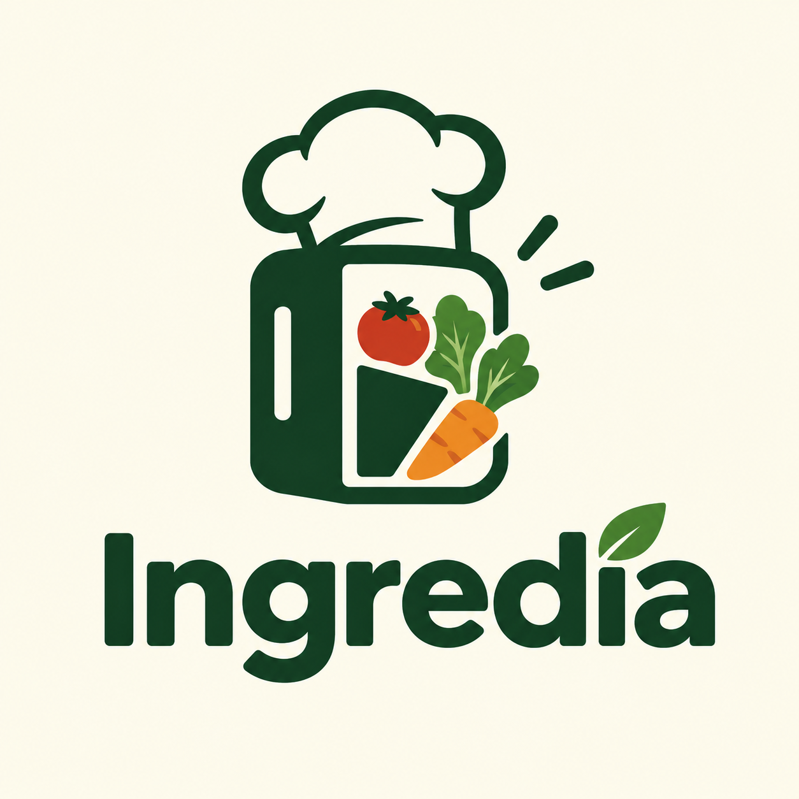

# Ingredia

<div align="center">
  
  <p><strong>Good food starts with what you have.</strong></p>
</div>

Ingredia is an AI-based recipe recommendation app that helps users find meals using ingredients they already have at home. Users can upload pictures of food or refrigerator contents, review the ingredients detected by AI, and get recipe recommendations based on what is available.

The app also allows users to explore recipes, view nutrition information, save recipes, and create shopping lists.

This project was developed for **CSCI 270: Applied AI** at the **College of Charleston**.

## Team Members

- Snovi Patel
- Jaden Morales
- Philip Pagana
- Amelia West

## Main Features

### Ingredient Recognition

Ingredia uses Google Gemini to identify ingredients in uploaded images when an API key is configured. If Gemini is unavailable, the app uses local pretrained models, including Faster R-CNN and MobileNetV3-Small.

Since image recognition is not always accurate, users can add, remove, or correct ingredients before finding recipes.

### Recipe Recommendations

The app compares the detected or selected ingredients with a recipe dataset containing 120 recipes.

Recipes are ranked based on ingredient matches, while also considering common pantry ingredients and supported substitutions.

Each recommendation includes information such as the match score, missing ingredients, preparation time, cooking instructions, and estimated nutrition.

### Recipe Catalog

Users can browse the available recipes without uploading an image.

### Nutrition Information

The app displays estimated calories, protein, carbohydrates, and fat for recipes. Nutrition charts are also included.

### Saved Recipes and Shopping List

Users can save recipes they like and add missing ingredients to a shopping list.

## Technologies Used

| Technology | Purpose |
|---|---|
| Python | Main programming language |
| Streamlit | Application interface |
| PyTorch and torchvision | Image recognition models |
| Google Gemini | Cloud-based ingredient recognition |
| Pillow | Image processing |
| NumPy | Image and numerical processing |
| Pandas | Recipe dataset processing |
| scikit-learn | Supporting machine learning tools |
| Hugging Face Datasets | Loading datasets for model training |
| pytest | Automated testing |
| GitHub | Version control and team collaboration |

## Project Structure

The project is organized into separate folders for the application, recipe data, AI models, training, documentation, and testing.

```text
FridgeApp/
├── .ai/
│   └── codingrules.md              # Project coding guidelines
├── .streamlit/
│   ├── config.toml                 # Streamlit configuration
│   └── style.css                   # Custom app styling
├── assets/
│   └── ingredia_logo.png           # App logo
├── data/
│   ├── raw/
│   │   ├── README.md               # Sample data information
│   │   ├── annotations.example.json # Example image annotations
│   │   ├── sample_breakfast.png
│   │   ├── sample_fruit.png
│   │   └── sample_produce.png       # Sample images for testing
│   └── processed/
│       └── recipes.csv             # Recipe dataset
├── docs/
│   ├── project_design_doc.md       # Project design document
│   └── project_proposal.md         # Project proposal
├── models/
│   └── README.md                   # Model checkpoint information
├── scratch/
│   └── expand_recipes.py           # Recipe dataset utility
├── src/
│   ├── __init__.py
│   ├── app.py                       # Main Streamlit application
│   ├── backend.py                   # Shared app functions and UI logic
│   ├── cloud_vision.py              # Gemini ingredient recognition
│   ├── detector.py                  # Local object detection
│   ├── ingredient_classifier.py     # Fine-tuned model support
│   ├── nutrition.py                 # Nutrition calculations
│   ├── recipe_engine.py             # Recipe matching and ranking
│   ├── utils.py                     # Ingredient names and substitutions
│   ├── vision_model.py              # Local image classification
│   └── views/
│       ├── explore_catalog.py       # Recipe catalog page
│       ├── find_recipes.py          # Ingredient detection and recipes
│       ├── saved_recipes.py         # Saved recipes page
│       ├── settings.py              # Settings page
│       └── shopping_list.py         # Shopping list page
├── tests/
│   ├── test_detector_and_engine.py  # Detection and recipe engine tests
│   ├── test_fridgeapp.py            # Application tests
│   └── test_training.py             # Training-related tests
├── train/
│   ├── README.md                    # Model training instructions
│   ├── __init__.py
│   ├── __main__.py                  # Training entry point
│   ├── dataset.py                   # Training dataset preparation
│   ├── huggingface.py               # Hugging Face dataset loading
│   ├── train_classifier.py          # Image classifier training
│   ├── train_detector.py            # Object detection training
│   └── train_hf_classifier.py       # Hugging Face classifier training
├── .gitignore                       # Files excluded from Git
├── README.md                        # Project overview and setup
└── requirements.txt                 # Python dependencies
```

## How to Run the App

The project uses Python 3.10 or 3.11.

### 1. Download the Project

Clone the repository using Git:

`git clone https://github.com/moralesjs-hub/FridgeApp.git`

Then open the project folder:

`cd FridgeApp`

You can also download the ZIP file from GitHub and open the extracted folder in VS Code.

### 2. Create a Virtual Environment

Run:

`python -m venv .venv`

Activate the environment.

For Windows PowerShell:

`.\.venv\Scripts\Activate.ps1`

For macOS or Linux:

`source .venv/bin/activate`

### 3. Install Dependencies

Upgrade pip:

`python -m pip install --upgrade pip`

Install the required packages:

`python -m pip install -r requirements.txt`

### 4. Run the Application

Start Streamlit:

`python -m streamlit run src/app.py`

The application will open in your browser. You can then upload your own food images or select one of the sample images included in the project.

## Gemini API Setup

Ingredia can use Google Gemini for ingredient recognition.

To enable Gemini:

1. Create an API key through Google AI Studio.
2. Create a file named `.env` in the main project folder.
3. Add the following line, replacing the placeholder with your actual key:

`GEMINI_API_KEY=your_api_key_here`

4. Save the file and restart the application.

The `.env` file should not be uploaded to GitHub because it contains a private API key.

If Gemini is not configured, the app can still use the local image recognition models.

## How the App Works

1. The user uploads an image or selects a sample image.
2. The app processes the image and attempts to recognize ingredients using Gemini or the local models.
3. The detected ingredients are displayed so the user can review and correct them.
4. The recipe engine compares the ingredients with the recipe dataset.
5. Recipes are ranked based on their ingredient match scores.
6. The app displays matching recipes, missing ingredients, instructions, and nutrition information.
7. Users can save recipes or add ingredients to their shopping list.

## AI Models and Training

Ingredia uses pretrained computer vision models for local image recognition.

MobileNetV3-Small is used for image classification, while Faster R-CNN with MobileNetV3 FPN is used for object detection.

We also included training scripts for fine-tuning classification and detection models using food-specific datasets.

The `train/` folder contains the training code, and the `models/` folder is used for saved model checkpoints.

The current project includes the training scripts but does not include custom-trained checkpoints. The app can still run using pretrained models.

More information about training is available in `train/README.md`.

## Testing

We tested the application by uploading food images, checking ingredient predictions, and making sure recipe recommendations were generated correctly.

We also tested the interface, ingredient editing, and how the app handles incorrect or missing detections.

The project includes automated tests in the `tests/` folder.

To run the tests, use:

`python -m pytest -q tests`

## Current Limitations

The image recognition system may not identify every ingredient correctly, especially when multiple items appear in one image or when foods look similar.

Users can manually correct the detected ingredients to improve recipe recommendations.

The recipe catalog is limited to the recipes included in the dataset, and nutrition values are estimates that may vary depending on ingredients and serving sizes.

## Project Goal

Our goal was to combine AI image recognition with a recipe recommendation system that people could use in everyday situations.

Ingredia helps users make better use of ingredients they already have, find meals more easily, and keep track of ingredients they might need to buy.
