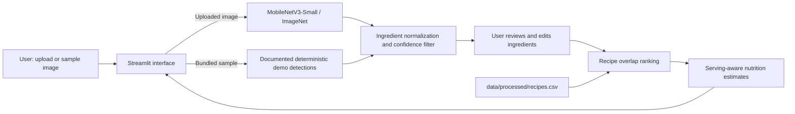

# Project Design Document

## System overview



## Modules and data flow

- `src/app.py` owns Streamlit state, image upload/sample selection, controls, and rendering. Uploaded images are read in memory and not saved.
- `src/vision_model.py` lazily initializes torchvision's pretrained MobileNetV3-Small, transforms an image, computes class probabilities, and maps supported labels to ingredients.
- `src/utils.py` provides shared text normalization and ingredient aliases used on both sides of matching.
- `src/recipe_engine.py` reads and validates the curated CSV, then calculates the overlap score and missing ingredient list.
- `src/nutrition.py` validates serving counts and scales per-serving calorie and macro estimates.
- `data/raw/` holds illustrative sample inputs and documentation about optional source datasets. `data/processed/recipes.csv` is the application's cleaned, curated recipe catalog.

### Image path

An uploaded JPG or PNG (up to 10 MB) is decoded with Pillow, converted to RGB, resized and normalized using the selected torchvision weights' preprocessing transform, and passed through MobileNetV3-Small. Softmax probabilities are considered in descending order. Only class labels with an explicit supported ingredient mapping and probability at or above the user-selected threshold are returned. Results are cached by image digest and confidence threshold so ordinary UI reruns do not repeat inference. The UI lets users review the result before ranking recipes.

The `sample_*.png` files use a filename-to-ingredient manifest in the app for deterministic demonstrations. This route intentionally bypasses the classifier and is labeled as demo data in the UI. On an uploaded image, model initialization or weight download errors are reported in the interface rather than replaced with fake predictions.

### Recipe CSV path

The curated processed CSV stores ingredients and instructions as JSON-encoded string arrays in individual cells. The loader parses those arrays, normalizes ingredient names, rejects malformed or duplicate records with a useful error, and keeps optional nutrition fields nullable. External data ingestion is not part of this app; if introduced, raw source files must remain unchanged in `data/raw/`, with licensed, documented cleaned output written separately.

## Model selection and trade-offs

MobileNetV3-Small is selected as a compact CPU-capable torchvision model, avoiding the inference cost of ResNet50. torchvision pretrained ImageNet weights are acquired on first uploaded-image inference. This is transfer learning in the sense that pretrained weights are used for inference, not fine-tuned in this project. The 1,000 ImageNet categories are not a refrigerator-food label set; mapping labels to ingredients is a constrained baseline, not a claim of accurate food detection. Fine-tuning a food-specific classifier would require a licensed, labeled image dataset, training/evaluation splits, and a separate evaluation phase.

The app avoids initializing the model for its built-in sample path. Consequently, the sample walkthrough works offline, while arbitrary uploads require torchvision and availability of the pretrained weights (including a cached copy).

## Recipe ranking

Let `D` be the set of normalized user-confirmed ingredients and `R` a recipe's normalized ingredient set:

```text
score(D, R) = |D ∩ R| / |R|
```

Scores range from 0 to 1; an empty recipe ingredient list is invalid. Results are ordered by score, then by recipe name for deterministic ties. The UI reports percentage match, ingredients available, and missing ingredients. This simple coverage metric is explainable but does not model quantities, substitutions, dietary preferences, or ingredient importance.

## Nutrition estimation

Calories and optional protein/carbohydrate/fat values in the starter CSV are approximate per-serving estimates. The nutrition helper multiplies per-serving values by a positive requested serving count and omits unavailable metrics. A 2,000 kcal daily reference and general macro reference values may be shown for context only; they are not personalized targets or medical guidance.

## Error handling and limitations

- Unsupported file types and unreadable images are rejected with actionable UI messages.
- Missing recipe data or invalid CSV rows produce explicit errors rather than an empty success state.
- If torchvision import, model construction, or pretrained-weight acquisition fails, uploaded-image inference reports the cause; users can still try samples and manual ingredient entry.
- Poor lighting, occlusion, unusual camera angles, packaging, and multiple overlapping objects can cause missed or incorrect classifications.
- Confidence is the model's ImageNet class probability, not a calibrated probability that a named ingredient is present.
- The ingredient vocabulary is intentionally small. An unrecognized object is omitted; users can add it manually.
- Calorie and macro data are estimates; ingredient quantities, brands, cooking methods, allergens, and food safety are not inferred.

## Installation and execution

Use Python 3.10 or 3.11, install `requirements.txt` in a virtual environment, then launch from the repository root with `streamlit run src/app.py`. The first inference on an uploaded image may download ImageNet weights. See the repository README for platform-specific activation commands.
