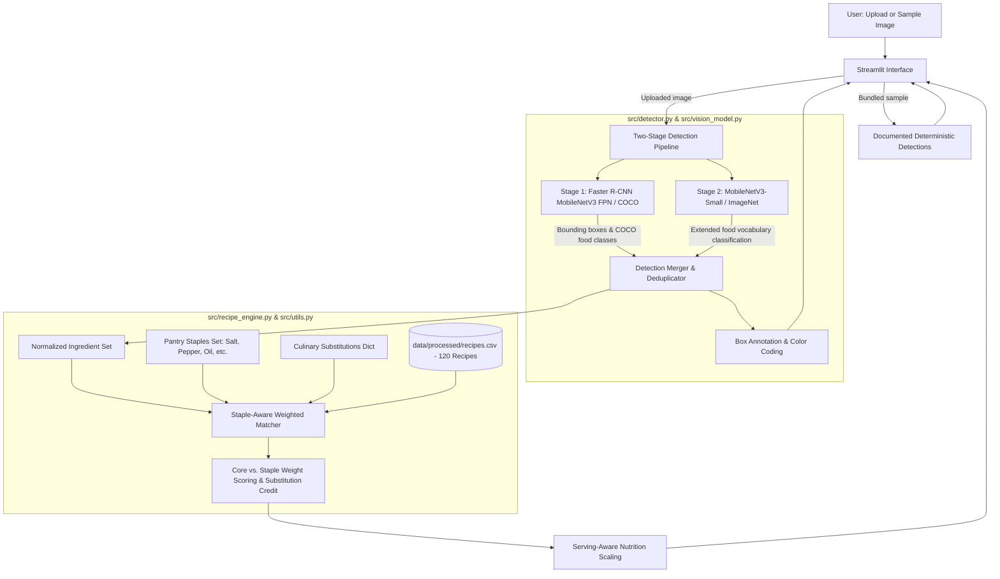

# Project Design Document

## System overview

## Modules and data flow

- `src/app.py` owns Streamlit state, image upload/sample selection, controls, and rendering.
- `src/detector.py` orchestrates the two-stage local vision detection: Faster R-CNN provides spatial bounding boxes on common items, while MobileNetV3-Small classifies whole-scene food categories to support non-COCO items. Also provides bounding box drawing with culinary category color palettes.
- `src/vision_model.py` provides standalone MobileNetV3-Small classification for backward compatibility.
- `src/utils.py` manages text normalization, an alias dictionary with 200+ food terms, non-perishable pantry staples definitions, and common culinary substitutions.
- `src/recipe_engine.py` reads and validates `recipes.csv` (60 recipes across breakfast, lunch, dinner, and sides), scores recipes taking pantry staples and substitutions into account.
- `src/nutrition.py` validates serving counts and scales per-serving calories and macronutrient estimates.
- `data/raw/` holds sample demonstration inputs.
- `data/processed/recipes.csv` contains the curated 120-recipe dataset.

### Image path

An uploaded JPG or PNG (up to 10 MB) is processed in-memory with Pillow. The image is passed through `FoodDetector`:
1. **Stage 1 (Faster R-CNN MobileNetV3 FPN):** Evaluates bounding boxes and spatial locations for COCO food classes (apples, bananas, carrots, oranges, broccoli, bread, sausage, cheese, etc.).
2. **Stage 2 (MobileNetV3-Small):** Evaluates whole-image probability distribution across ImageNet classes, mapping botanical and culinary categories (nightshades, alliums, dairy, meats, seafood, herbs).
3. **Merging & Annotation:** Detections are canonicalized via `ingredient_from_label()`, deduplicated, and optionally annotated with category-colored bounding boxes and confidence badges.

### Recipe ranking and substitution model

Let $C_R$ be the set of core (non-staple) ingredients required by recipe $R$, and $P_R$ be the set of recipe ingredients classified as pantry staples. Let $U$ be the set of available user ingredients.

When pantry staples are assumed present (`assume_staples=True`), staple ingredients are treated as satisfied. For each core ingredient $c \in C_R$:
- If $c \in U$, match weight is $1.0$.
- Else if any substitute $s \in \text{get\_substitutes}(c)$ is in $U$, substitution match weight is $0.8$.
- Otherwise, match weight is $0.0$.

The recipe score is calculated as:
$$\text{score}(U, R) = \frac{\sum_{c \in C_R} \text{weight}(c)}{|C_R|}$$

If all ingredients in a recipe are staples, the standard intersection ratio over all ingredients is used. Results are sorted descending by score, followed by alphabetical recipe name for deterministic ties. Missing core ingredients and substitutions used are surfaced transparently to the user.

## Nutrition estimation

Calories and macronutrients (protein, carbohydrates, fat) in `recipes.csv` are approximate per-serving estimates. The nutrition module scales values linearly by positive user serving counts.

## Error handling and limitations

- Local torchvision models run entirely in CPU inference mode without sending data to external APIs.
- Missing weights trigger explicit download handling or fallback notifications without crashing.
- Pretrained COCO labels cover only 10 food classes with bounding boxes; non-COCO foods rely on Stage 2 classifier labels without spatial bounding boxes.
- Nutrition values and substitutions are heuristic estimates, not medical or allergen advice.
